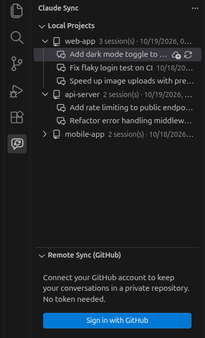
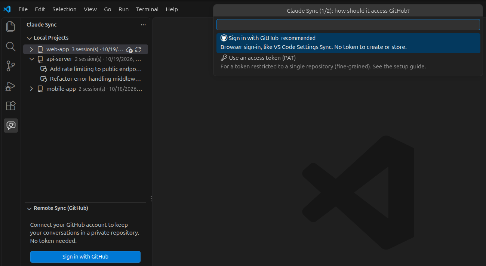

# Claude Code Sync

**English** · [Português](README.pt-BR.md)

[](https://marketplace.visualstudio.com/items?itemName=kslabs.claude-code-session-sync)
[](https://marketplace.visualstudio.com/items?itemName=kslabs.claude-code-session-sync)
[](https://github.com/lucaskge/claude-code-sync/actions/workflows/ci.yml)
[](LICENSE)

**Sync Claude Code conversations (sessions, subagents, tool results) across machines via your own private GitHub repository — with a lossless merge and full version history.**

Start a conversation on your desktop and continue it on your laptop. When the same conversation moves forward on two computers, both versions are merged event by event, so nothing is ever overwritten — and every sync is a Git commit you can roll back.



> Independent, unofficial project. Not affiliated with Anthropic. "Claude" and "Claude Code" are trademarks of Anthropic.

---

## What makes it different

Most sync tools copy whole files or project snapshots, so when two machines change the same conversation, **the last one to sync wins** and the other side's messages are lost. Claude Code Sync was built around that problem:

| | Claude Code Sync | Typical file / snapshot sync |
|---|---|---|
| **Same conversation continued on two machines** | Both sides merged **event by event** — nothing lost | Last writer wins; the other side's messages are overwritten |
| **History** | Every sync is a **Git commit**: any previous state can be restored | Only the latest copy (or a few dated backups) |
| **Where data lives** | A **private GitHub repository you own**, readable as plain files | A cloud drive folder or a proprietary format |
| **Setup** | GitHub sign-in built into VS Code — no tokens, no OAuth app to register | May require setting up API credentials |
| **Huge sessions** (pasted images) | Compressed and split automatically, verified byte by byte | Subject to the storage service's upload limits |
| **Granularity** | Everything, a project, or **individual conversations** | Usually whole projects |

**What it doesn't do (yet):** sync memory, skills, `CLAUDE.md` or `settings.json`. It focuses on conversation history and does that without data loss.

## Why Claude Code Sync

| | |
|---|---|
| 🔀 **Lossless merge** | Conversations are merged **line by line (event by event)**, not file by file. If you kept chatting on two machines, you get both branches of the conversation — no "last writer wins". |
| 🕓 **Full version history** | Every sync is a Git commit. Any previous state of any conversation can be recovered from the repository history. |
| 🔐 **Your repo, your data** | Backups go to a private repository in **your** GitHub account. No third-party servers, no telemetry. |
| ⚡ **Zero setup** | Sign in with the GitHub account built into VS Code. No tokens to create, no OAuth apps to register, no Git CLI required. |
| 🛡️ **Safe by design** | Never deletes local conversations, never touches a session that is being written, and creates a `.bak` before replacing anything. |
| 🗂️ **All your projects, any path** | The same project can live at `/home/me/app` on Linux and `C:\Users\me\app` on Windows — it's recognized by its Git remote, so its conversations show up in the right place on every machine. |
| 🎯 **Sync what you want** | Everything, the current project, selected projects, or individual conversations. |

---

## Quick start

1. **Install** the extension from the [Marketplace](https://marketplace.visualstudio.com/items?itemName=kslabs.claude-code-session-sync), or in VS Code: `Ctrl+Shift+X` → search for **Claude Code Sync** (publisher **KS Labs**).
2. **Sign in:** open the **Claude Sync** icon in the activity bar → **Sign in with GitHub** and authorize in the browser.

   

3. **Pick a repository:** accept the suggestion (`your-user/claude-code-backup`). If it doesn't exist, the extension creates it as **private**.
4. **Back up your current history once** before the first sync, just in case:
   ```bash
   cp -r ~/.claude/projects ~/claude-projects-backup
   ```
5. Click **🔄 Sync**.

On another machine, repeat steps 1–3 with the **same GitHub account** and the **same repository**, then click **🔄 Sync**.

📘 Step-by-step guide with troubleshooting: [docs/SETUP.md](docs/SETUP.md)

> 🌐 The interface is available in **English** and **Portuguese (Brazil)** and follows VS Code's display language. More translations are welcome — see [CONTRIBUTING.md](CONTRIBUTING.md).

---

## Features

### Sync
- **Push**, **Pull** or **bi-directional Sync**, for everything, the current workspace, selected projects or specific conversations.
- **Optional auto-sync** in the background, at a configurable interval and on startup.
- Also syncs each session's subagent transcripts and tool results (`<session>/subagents/`, `<session>/tool-results/`).
- **Large sessions** (pasted images can push them past 100 MB) are compressed and split into parts automatically, then reassembled and verified byte by byte on the other machine.

### Lossless merge

| Situation | Push | Pull | Sync |
|---|---|---|---|
| Conversation only on this machine | uploads | keeps | uploads |
| Conversation only on GitHub | — | downloads | downloads |
| Local has everything remote has, and more | uploads | keeps | uploads |
| Remote has everything local has, and more | **doesn't overwrite** (warns) | updates local | updates local |
| Both sides have new events | uploads the union | `.bak` + writes the union | `.bak` + union on both sides |

- No line from either side is ever dropped. Diverging events are interleaved by timestamp.
- Before replacing a local file, a `<session>.jsonl.<date>.bak` copy is saved next to it.
- Sessions modified in the last 10 seconds (in use by Claude Code) are never overwritten; they're updated on the next sync.
- Local writes are atomic and are cancelled if the file changes mid-sync.
- If another machine pushes during a sync, the extension re-reads the repository and merges again.

### Projects across machines
The same project usually lives at different paths on each machine (`/home/me/app` vs `C:\Users\me\app`). Projects are matched by their **Git remote URL** (`origin`), so conversations land in the right place automatically. Projects without a Git remote are matched by folder name, and you can map any remote project to a local folder by hand.

### Sidebar
- **Local Projects** and **Remote Sync (GitHub)** views, with a status icon for every conversation: synced, local only, remote only, or different.
- Push / Pull / Sync buttons on every item; multi-select with Ctrl/Shift.
- Status bar indicator: `Claude Syncing...` → `Claude Synced`. Click it to sync.

---

## What gets synced

| Path | Synced |
|---|---|
| `~/.claude/projects/<project>/<session>.jsonl` — conversation history | ✅ |
| `~/.claude/projects/<project>/<session>/…` — subagents, tool results | ✅ |
| `*.bak` backups created by the extension | ❌ |
| Memory, skills, `CLAUDE.md`, `settings.json` | ❌ not yet |

The repository layout is plain and readable:

```
repos/<project-key>/<session-id>.jsonl
repos/<project-key>/<session-id>/...
repos/<project-key>/metadata.json      # titles, dates, known paths per machine
```

---

## Commands

All commands are under **Claude Sync** in the Command Palette (`Ctrl+Shift+P`).

| Command | What it does |
|---|---|
| Configure GitHub Credentials | Sign in and choose the backup repository |
| Full Synchronization (Push + Pull) | Sync everything both ways |
| Push Local Sessions to GitHub | Upload (all, current project, selected projects or conversations) |
| Pull Remote Sessions from GitHub | Download (same options) |
| Select Specific Sessions to Sync | Pick individual conversations |
| Change Backup Repository | Switch repositories; the old backup is left untouched |
| Switch GitHub Account | Use another GitHub account or a token |
| Sign Out (Disconnect from GitHub) | Stop syncing; nothing is deleted |
| Toggle Auto-Sync | Turn background sync on or off |
| Show Log | Details of every sync |

## Settings

| Setting | Default | Description |
|---|---|---|
| `claudeSync.githubRepoUrl` | — | Backup repository (`user/repo`, `https://github.com/user/repo` or `git@github.com:user/repo.git`) |
| `claudeSync.autoSync` | `false` | Background sync |
| `claudeSync.autoSyncInterval` | `30` | Minutes between background syncs |
| `claudeSync.syncOnStartup` | `true` | Sync when VS Code opens (if auto-sync is on) |
| `claudeSync.githubToken` | — | Optional plain-text token. Prefer signing in, or entering the token through the configure command (stored in VS Code's secret storage) |

These settings only apply from **User** settings. Values in a project's `.vscode/settings.json` are ignored on purpose — see [Security](#security--privacy).

---

## Security & privacy

> ⚠️ **Your Claude Code conversations can contain source code, passwords and API keys.** They're stored in your GitHub repository without additional encryption. Keep the repository **private** and don't add collaborators.

**Where your data goes**

| Data | Where |
|---|---|
| Conversations | Your machine and your private GitHub repository |
| GitHub sign-in | Managed by VS Code; the extension stores nothing |
| Manual token (if used) | VS Code secret storage (OS keychain), never `settings.json` |
| Network requests | `https://api.github.com` only |
| Telemetry / analytics | **None** |

**Built-in protections**
- **Public repositories are blocked.** Before every upload the extension checks that the repository is still private. If it was made public, nothing is sent.
- **Opened projects can't control the extension.** Settings are user-level only, so a malicious repository can't redirect your backup or turn on auto-sync through its `.vscode/settings.json`.
- **Data coming from GitHub is treated as untrusted:** path traversal (`..`) is rejected, nothing is ever written outside `~/.claude/projects`, names are validated, compressed files can't expand beyond their declared size, and remote metadata is validated field by field.
- **Tokens never appear in logs**, and credentials in Git remote URLs are stripped before being stored.

**Risks you should know about**
1. **Anyone with write access to your backup repository can inject conversations** into your machines. Never share it.
2. **Signing in with VS Code grants the `repo` scope**, which covers all repositories in your account. To restrict access to a single repository, use a fine-grained token instead ([how-to](docs/SETUP.md#appendix--using-a-personal-access-token)).
3. **If a secret ends up in a conversation, rotate it.** Deleting the file doesn't remove it from the Git history.
4. **Enable two-factor authentication** on your GitHub account.

Revoke access anytime at [github.com/settings/applications](https://github.com/settings/applications) → **Authorized OAuth Apps** → **Visual Studio Code** → **Revoke**.

Found a vulnerability? Please report it privately — see [SECURITY.md](SECURITY.md).

---

## FAQ

**Does it work without Git installed?**
Yes. It talks to GitHub's REST API directly; no Git CLI is needed.

**Will it delete or overwrite my conversations?**
No. Local conversations are never deleted. When a local file must be replaced, a `.bak` copy is created first, and every remote change is a Git commit you can roll back.

**What if I continue the same conversation on two machines?**
Both sides are merged event by event. Claude Code rebuilds the conversation from its message links, so the diverging parts show up as branches of the same conversation.

**Does it work on Windows, macOS and Linux?**
Yes, including syncing between different operating systems.

**Can I use an organization repository?**
Yes, as long as the organization allows the VS Code GitHub app, or you use a token with access to the repository.

**Is the backup encrypted?**
Not beyond what GitHub provides for private repositories. Treat the repository as sensitive and keep it private.

**Is this an official Anthropic extension?**
No. It's an independent open-source project.

---

## Development

Requirements: Node.js 22+ and VS Code 1.85+.

```bash
npm install
npm test           # merge, sync engine (two simulated machines with a fake GitHub) and security tests
npm run package    # builds the .vsix
```

Press **F5** in VS Code to launch an Extension Development Host. See [CONTRIBUTING.md](CONTRIBUTING.md) for the project structure, rules and release process.

## Contributing

Issues and pull requests are welcome! Please read [CONTRIBUTING.md](CONTRIBUTING.md) first, and never paste real conversations into issues.

## License

[MIT](LICENSE) © lucaskge
